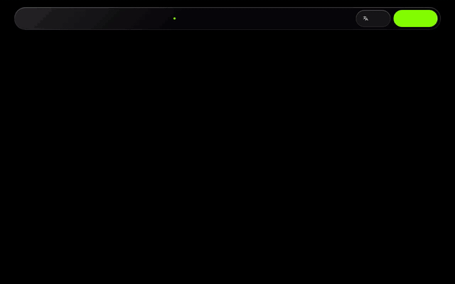
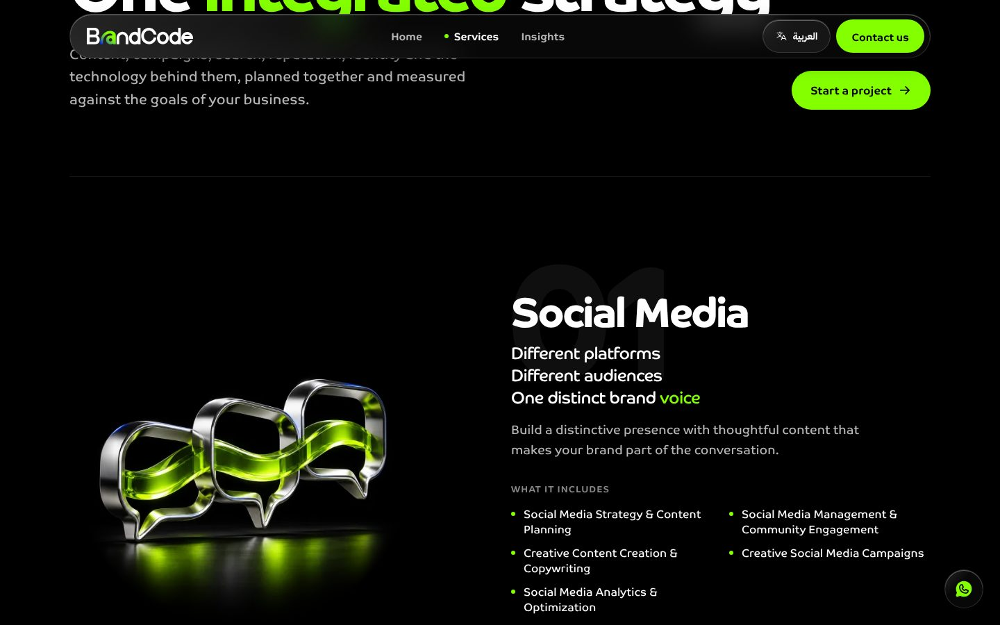
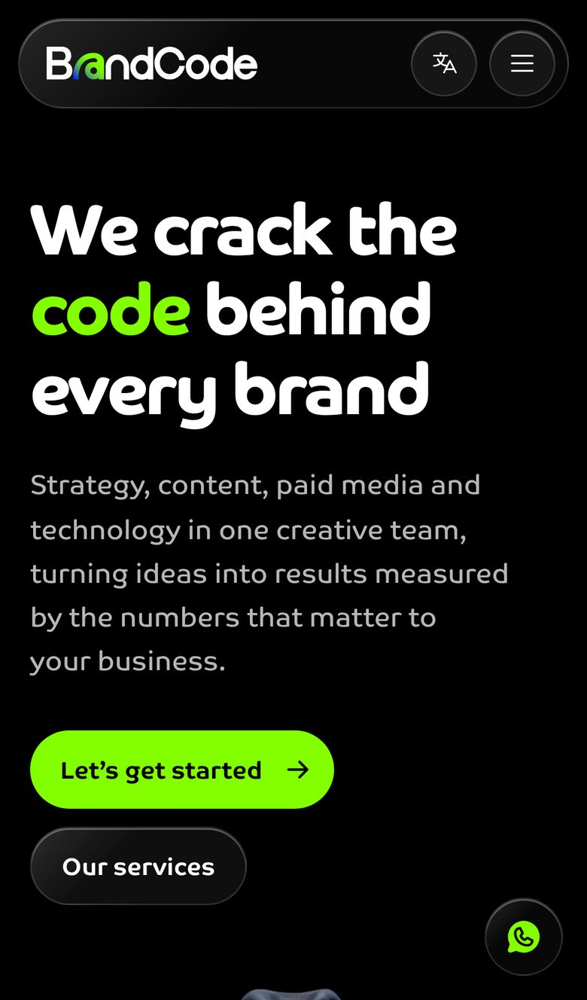
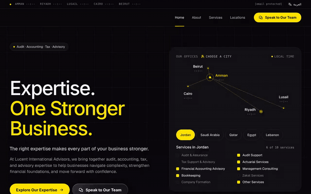
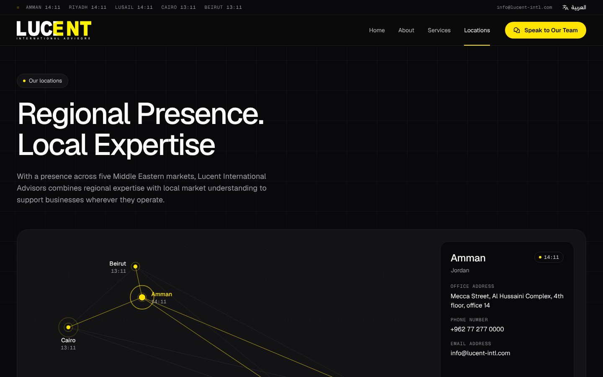
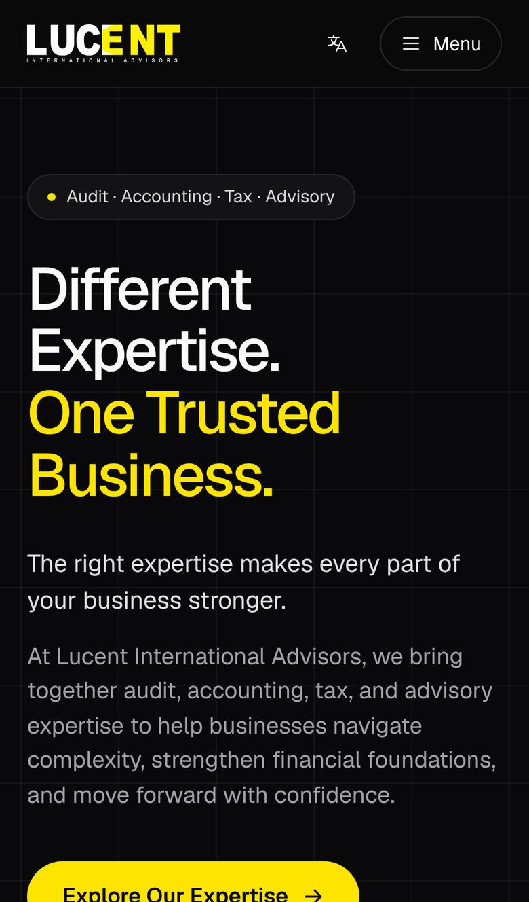
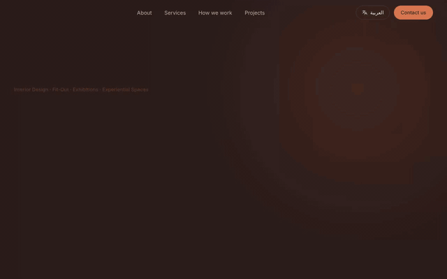
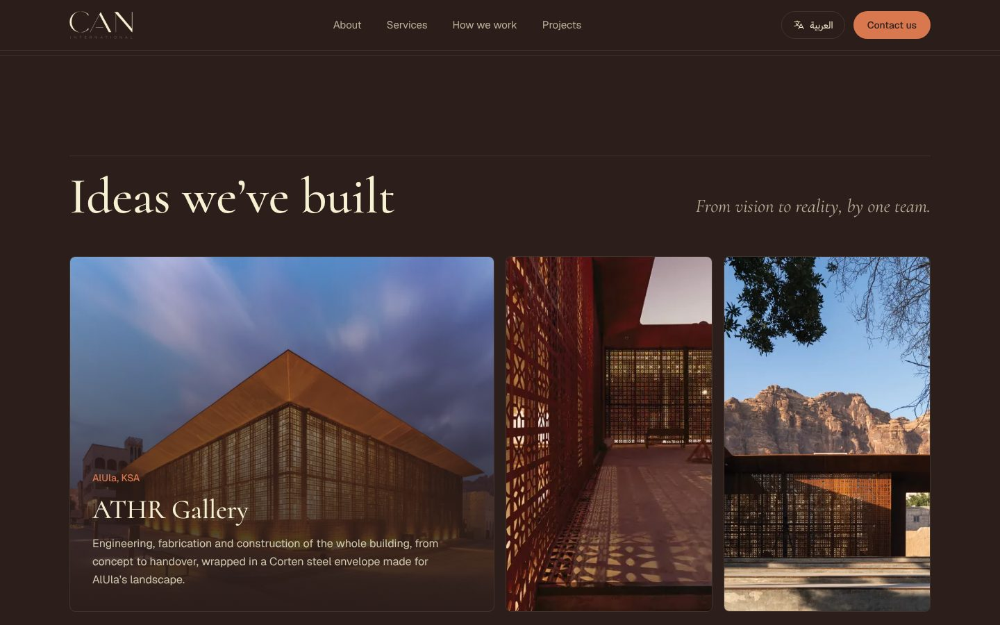
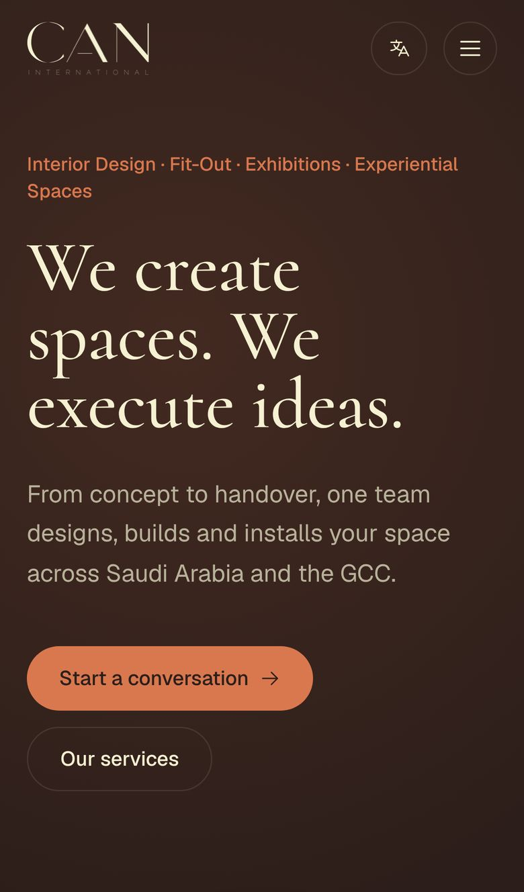

<h1 align="center">Zaid Al-Sabbagh · BrandCode Showcase</h1>

  Websites I built as Lead Software Engineer at <a href="https://bcodepr.com">BrandCode</a>, a PR and marketing agency in Amman.
   
  Each one is bilingual (English and Arabic), designed into code, built, deployed and maintained by me, end to end.

  <a href="https://www.linkedin.com/in/zaid-sabbagh-6a7287227">LinkedIn</a> ·
  <a href="mailto:sabbaghzaid88@gmail.com">sabbaghzaid88@gmail.com</a> ·
  <a href="https://professional-portfolio-v2-dis2.vercel.app">Portfolio</a> ·
  <a href="https://github.com/mercenary19961">GitHub</a> ·
  <a href="https://github.com/mercenary19961/showcase">Earlier client work</a>

---

The source code for these projects is private, because it belongs to BrandCode and its clients. This repository shows what each one is, how it was built at a high level, and where to see it live. I am happy to walk through the code and architecture in an interview.

| Project | What it is | Live |
|---|---|---|
| [BrandCode](#brandcode) | PR and marketing agency website with a full admin panel | [bcodepr.com](https://bcodepr.com) |
| [Lucent International Advisors](#lucent-international-advisors) | Audit and advisory firm with offices in five countries | [lucent-intl.com](https://lucent-intl.com) |
| [CAN International](#can-international) | Interior design, fit-out and exhibitions company in Riyadh | [canintlco.com](https://canintlco.com) |

**Shared stack:** Laravel 13 · Inertia.js 3 · React 19 (React Compiler) · TypeScript · Tailwind CSS 4 · Motion · MySQL · Resend · deployed on Railway behind Cloudflare, with server-side rendering for SEO. The three sites share one foundation that I built and keep improving: language in the URL (`/` and `/ar`), a typed translation file where a missing Arabic string fails the build, a validated contact pipeline, security headers and CI gates.

---

## BrandCode

**The agency's own website, with an admin panel the team uses every day for enquiries, articles and the team itself.**

🔗 **Live:** [bcodepr.com](https://bcodepr.com) · 📅 2026

  
  

<!-- 🎬 Walkthrough video -->

https://github.com/user-attachments/assets/a30f585d-1beb-4626-8e3d-50f39edae490

**Highlights**
- English and Arabic, right to left, with the language in the URL and server-side rendering
- Contact form protected by Cloudflare Turnstile, with country-aware phone validation (libphonenumber)
- Admin panel: enquiry inbox with statuses and notes, team roles, settings, and an overview with Search Console data
- Articles with an editor, scheduling, authors, review notes, notifications and a full history of every change
- Excel and Word exports, image processing to WebP on a storage bucket
- Its own page loader and a short animated thank-you scene after a send
- Error monitoring with Sentry; a team page of Gmail signatures served from the site

`Laravel 13` `Inertia.js 3` `React 19` `TypeScript` `Tailwind CSS 4` `Motion` `MySQL` `Sentry` `Resend`

---

## Lucent International Advisors

**Company website for an audit, accounting, tax and advisory firm in Jordan, Saudi Arabia, Qatar, Egypt and Lebanon.**

🔗 **Live:** [lucent-intl.com](https://lucent-intl.com) · 📅 2026

  
  

<!-- 🎬 Walkthrough video -->

https://github.com/user-attachments/assets/ca59e34b-410e-448d-aa38-9961a7e63545

**Highlights**
- Interactive offices map: pings, hover previews and a page per office for all five countries
- Animated home headline with a cycling word and a text-scramble effect
- Thirty client logos drifting in two rows that pause under the pointer
- Services, About, Locations, Clients and Contact pages, in English and Arabic
- 76 old addresses redirected with 301s and retired posts answering 410, so search rankings carried over
- Enquiry inbox in the admin panel, mail through Resend, cookie consent, structured data for every office

`Laravel 13` `Inertia.js 3` `React 19` `TypeScript` `Tailwind CSS 4` `Motion` `MySQL` `Resend`

---

## CAN International

**One-page website for a Riyadh interior design, fit-out and exhibitions company working across Saudi Arabia and the GCC.**

🔗 **Live:** [canintlco.com](https://canintlco.com) · 📅 2026

  
  

<!-- 🎬 Walkthrough video -->

https://github.com/user-attachments/assets/7f99daad-3d23-4543-8463-f0b64227e7a9

**Highlights**
- WebGL globe in the hero (cobe) with arcs from Riyadh across the GCC, which you can drag and it glides back
- Smooth scrolling (Lenis) and scroll-driven reveals that respect reduced-motion settings
- Services, process, sectors and project sections, in English and Arabic
- Contact form with field-by-field checks, phone numbers valid for each country, Arabic digits accepted
- Privacy page written for Saudi Arabia's Personal Data Protection Law, with old enquiries deleted automatically
- Hard bundle-size budget and Lighthouse checks in CI

`Laravel 13` `Inertia.js 3` `React 19` `TypeScript` `Tailwind CSS 4` `Motion` `cobe` `Lenis`

---

  Screenshots, logos and brand assets belong to their respective owners and are shown here as examples of my work.

